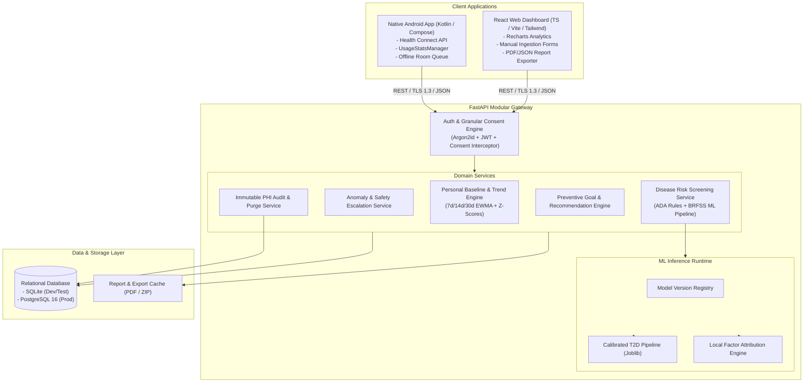

# Wellness Anticipator

> **“From Reactive Disease Treatment to Personalized Preventive Wellness.”**

[](docs/IMPLEMENTATION_ROADMAP.md)
[](LICENSE)
[](docs/SYSTEM_ARCHITECTURE.md)

Wellness Anticipator is an extensible preventive-wellness platform designed to shift personal healthcare from late-stage crisis management to early, actionable, and explainable preventive guidance. 

The platform synthesizes **validated clinical history**, **point-in-time clinical observations** (blood pressure, fasting glucose), **passive wearable telemetry** (steps, sleep architecture via Android Health Connect), and **digital wellness signals** (screen time via Android UsageStatsManager) into transparent risk assessments and achievable lifestyle interventions.

---

## 1. System Architecture Overview



---

## 2. Core Clinical & Ethical Principles

1. **Strict Boundary Between Screening and Diagnosis:** Wellness Anticipator provides **preventive screening and wellness risk assessments**, not clinical diagnoses. It does not prescribe medications, adjust drug doses, or replace primary care consultations.
2. **Telemetric Independence:** Passive telemetry (steps, sleep stages, screen time) is used exclusively to evaluate lifestyle consistency and personal baselines. **Telemetry is never used in isolation to diagnose chronic disease.**
3. **No Synthetic Clinical Claims:** Tabular disease models are trained exclusively on verified epidemiological cohorts (CDC BRFSS). Synthetic data is never used to fabricate clinical performance claims.
4. **Transparent Explainability:** Model predictions always highlight top risk contributors and protective lifestyle factors without technical jargon.
5. **Data Sovereignty & Privacy by Design:** Granular per-domain consent, multi-tenant isolation, no third-party tracking, and 1-click GDPR "Right to be Forgotten" account deletion.

---

## 3. Proposed Repository Structure

```
Wellness Anticipator/
├── .gitignore
├── README.md                           # Root architecture & project guide
├── docker-compose.yml                  # Full stack local orchestration
├── docs/                               # Phase 0 Complete Project Documentation
│   ├── PROJECT_REQUIREMENTS.md         # PRD, user stories, functional/non-functional specs
│   ├── SYSTEM_ARCHITECTURE.md          # Architecture diagrams, data flows, components
│   ├── DATABASE_DESIGN.md              # ERD, canonical schemas, field dictionary, migrations
│   ├── API_SPECIFICATION.md            # REST API endpoints, JSON payloads, errors
│   ├── AI_ML_STRATEGY.md               # Dataset inventory, leakage prevention, ML pipelines
│   ├── IMPLEMENTATION_ROADMAP.md       # 4-phase rollout, sprint plans, Definition of Done
│   ├── SECURITY_AND_PRIVACY.md         # Consent engine, encryption, tenant isolation, GDPR
│   ├── TESTING_STRATEGY.md             # Multi-tier testing, ML validation, E2E journeys
│   ├── DECISIONS_AND_ASSUMPTIONS.md    # ADRs, operational assumptions, unresolved questions
│   └── REQUIREMENTS_TRACEABILITY.md    # Bidirectional requirement-to-test traceability
├── contracts/                          # Shared cross-platform contracts
│   ├── openapi.json                    # Exported OpenAPI 3.1 specification
│   └── schemas/
│       ├── health_data.json            # Canonical telemetry & vitals schemas
│       └── risk_assessment.json        # Assessment & factor attribution schemas
├── backend/                            # Python FastAPI Modular Monolith
│   ├── app/
│   │   ├── api/v1/endpoints/          # Domain API endpoints (auth, measurements, etc.)
│   │   ├── core/                       # Config, security, DB session management
│   │   ├── models/                     # SQLAlchemy 2.0 ORM models
│   │   ├── schemas/                    # Pydantic v2 schemas
│   │   ├── services/                   # Business logic, trend engine, risk engine
│   │   └── main.py                     # FastAPI application factory
│   ├── alembic/                        # Database migration scripts
│   ├── tests/                          # Pytest suite (unit, integration, security)
│   ├── requirements.txt
│   └── Dockerfile
├── ml/                                 # Dedicated Research & Training Pipeline
│   ├── data/                           # Data directory (raw, processed, inventory)
│   │   └── dataset_inventory.md
│   ├── pipelines/                      # Preprocessing, training, and evaluation scripts
│   │   ├── data_validation.py
│   │   ├── preprocessing.py
│   │   ├── train_diabetes_baseline.py
│   │   ├── train_diabetes_gbt.py
│   │   └── evaluate_model.py
│   ├── models/                         # Serialized joblib artifacts & registry
│   │   └── registry.json
│   ├── tests/                          # ML unit tests, calibration tests, leakage checks
│   └── requirements.txt
├── web/                                # React / TypeScript / Vite Dashboard
│   ├── src/
│   │   ├── components/                 # UI components (charts, forms, risk cards)
│   │   ├── pages/                      # Dashboard, Vitals Logging, Reports, Profile
│   │   ├── services/                   # Axios API client bindings
│   │   └── App.tsx
│   ├── package.json
│   └── vite.config.ts
└── android/                            # Native Kotlin Android Application
    ├── app/
    │   ├── src/main/java/.../
    │   │   ├── data/healthconnect/     # Android Health Connect sync adapter
    │   │   ├── data/usagestats/        # UsageStatsManager screen time collector
    │   │   ├── data/room/              # Offline Room database cache
    │   │   ├── domain/                 # Domain repositories and use cases
    │   │   └── ui/                     # Jetpack Compose screens and ViewModels
    │   └── build.gradle.kts
    └── build.gradle.kts
```

---

## 4. Phase-by-Phase Roadmap Summary

- **Phase 0: Complete Planning & System Architecture (CURRENT)**
  - Comprehensive requirements, schemas, ADRs, database design, ML evaluation strategy.
- **Phase 1: MVP Core Platform & Diabetes Prevention**
  - FastAPI backend with SQLite/Postgres support and JWT auth.
  - Validated ADA Risk Score + calibrated CDC BRFSS ML pipeline.
  - Native Android app with Health Connect sync and manual entry fallback.
  - React web dashboard with Recharts trends and PDF/JSON export.
- **Phase 2: Expanded Telemetry, Passive Screen Time & Engagement**
  - Android UsageStats screen-time aggregation and digital wellness insights.
  - Subjective nutrition and mood/stress check-ins.
  - Anomaly alerting (Z-score deviation detector) and active goal tracking.
- **Phase 3: Cardiovascular Risk & Advanced Clinical Informatics**
  - AHA/ACC 10-Year ASCVD risk engine with blood pressure phenotyping.
  - Standardized one-page clinician executive summary PDF.

---

## 5. Technology Stack

| Layer | Primary Technology | Rationale |
|---|---|---|
| **Android Client** | Kotlin, Jetpack Compose, Health Connect, UsageStatsManager | Native sensor access, smooth Material 3 UI, modern coroutines/Flow. |
| **Web Dashboard** | React 18/19, TypeScript, Vite, TailwindCSS, Recharts | Fast bundle, type safety, accessible data visualization. |
| **Backend API** | Python 3.11+, FastAPI, Pydantic v2, SQLAlchemy 2.0 | Async performance, strict schema enforcement, automatic OpenAPI docs. |
| **Database** | SQLite (Dev/Test) / PostgreSQL 16+ (Production), Alembic | Zero-dependency local developer onboarding with clean production scaling. |
| **AI / ML** | pandas, NumPy, scikit-learn, joblib | Reproducible tabular ML pipelines, calibrated probabilities, SHAP explainability. |
| **Testing** | pytest, pytest-asyncio, Vitest, JUnit 5, Robolectric | Comprehensive test coverage across backend, ML, web, and mobile layers. |

---

## 6. Documentation Index

For complete architectural and implementation details, consult the `docs/` library:

- [Project Requirements & User Stories (PRD)](docs/PROJECT_REQUIREMENTS.md)
- [System Architecture & Data Flows](docs/SYSTEM_ARCHITECTURE.md)
- [Database Design & Schema Dictionary](docs/DATABASE_DESIGN.md)
- [REST API Specification](docs/API_SPECIFICATION.md)
- [AI & Machine Learning Strategy](docs/AI_ML_STRATEGY.md)
- [Implementation Roadmap & Milestones](docs/IMPLEMENTATION_ROADMAP.md)
- [Security, Privacy & Compliance (GDPR/HIPAA)](docs/SECURITY_AND_PRIVACY.md)
- [Testing & Clinical Verification Strategy](docs/TESTING_STRATEGY.md)
- [Decisions & Assumptions (ADRs)](docs/DECISIONS_AND_ASSUMPTIONS.md)
- [Requirements Traceability Matrix (RTM)](docs/REQUIREMENTS_TRACEABILITY.md)

---

## 7. Development & Contribution Governance

1. **Phase Gate Enforcement:** Do not begin Phase 1 implementation until Phase 0 documentation has been reviewed and signed off.
2. **Clinical Safety Guarantee:** Never implement an unvalidated disease risk model or fabricate performance claims.
3. **Data Protection:** Never commit real user health information, unhashed passwords, or production secrets to source control.
