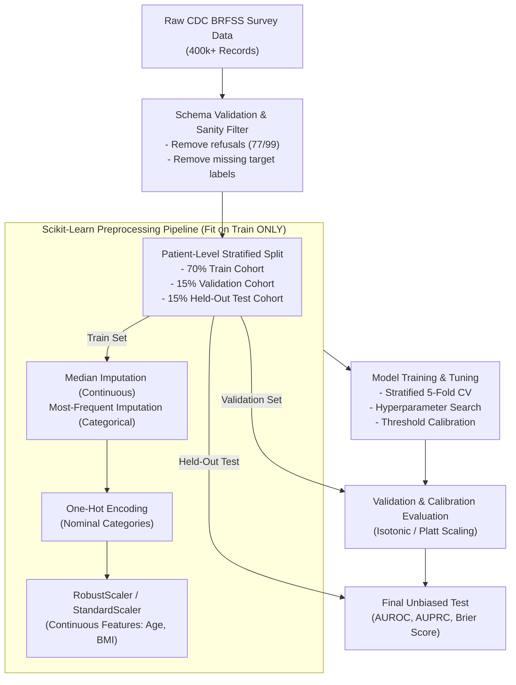

# Wellness Anticipator — AI & Machine Learning Strategy

**Document Version:** 1.0.0  
**Phase:** Phase 0 (Planning & Architecture)  
**Status:** Approved for Baseline Design  
**Author:** Healthcare AI/ML Research Lead & Lead Data Scientist  

---

## 1. Principles of Healthcare Machine Learning

Applying AI/ML to preventive healthcare demands rigorous clinical ethics, mathematical validation, and defensible safety constraints. In Wellness Anticipator, our machine learning strategy adheres strictly to five non-negotiable mandates:

1. **No Inferred Etiology from Consumer Telemetry:** Consumer wearables and smartphone sensors (steps, screen time, accelerometer sleep stages) capture *lifestyle behaviors*, not chronic disease etiology. The model **must never** diagnose or infer diabetes or cardiovascular pathology from steps, screen time, or sleep logs alone.
2. **Absolute Separation of Research Models from Clinical Decision Support:** Research models trained on public epidemiological surveys provide *population-level risk screening*, not individualized clinical diagnosis. Every prediction must explicitly communicate its statistical nature, confidence boundaries, and training population limitations.
3. **No Fabricated Data or Invented Performance Metrics:** We will never generate synthetic patient outcomes to claim inflated model accuracy. Training metrics (AUROC, AUPRC, Brier score) must derive solely from verified public research cohorts (e.g., CDC BRFSS, NHANES) using leak-free, reproducible cross-validation.
4. **Calibration Over Raw Accuracy:** In clinical risk screening, a model that predicts a 20% risk must mean that approximately 20 out of 100 similar individuals develop the outcome. Uncalibrated accuracy or F1-scores are clinically dangerous; we mandate probability calibration assessment via Brier score and reliability curves.
5. **Explainability as a Core Safety Feature:** "Black-box" predictions are inadmissible in health risk assessment. Every output must provide localized, attributable factor breakdowns (e.g., via SHAP or model coefficients) indicating what factors increased risk and what protective factors decreased risk.

---

## 2. Dataset Discovery & Documented Dataset Inventory

To establish a transparent, validated machine learning foundation for Type 2 Diabetes screening, we evaluate the prominent public healthcare datasets:

### 2.1 Dataset Candidates Evaluation

| Dataset Name | Primary Source / Authority | License / Access | Intended Population | Clinical Suitability for Preventive Screening | Decision & Rationale |
|---|---|---|---|---|---|
| **CDC BRFSS (Behavioral Risk Factor Surveillance System)** | Centers for Disease Control and Prevention (CDC) | Public Domain (US Gov) | US non-institutionalized adult population ($\ge 18$ years, $>400,000$ annual survey responses). | **Highest.** Contains exact screening features: age, BMI, physical activity, hypertension history, high cholesterol, smoking, diet, and diagnosed diabetes status. Direct basis of CDC/ADA risk tools. | **SELECTED as Primary Tabular Training Cohort.** Standardized survey questions align with self-reported app inputs. |
| **NHANES (National Health and Nutrition Examination Survey)** | CDC / National Center for Health Statistics (NCHS) | Public Domain (US Gov) | Representative sample of US civilian population with interview + physical exam + laboratory blood tests. | **High.** Provides true lab ground-truth (Fasting Plasma Glucose, HbA1c, OGTT), but sample size (~10,000 per 2-year cycle) is smaller and complex sampling weights are required. | **SELECTED as Secondary Validation & Threshold Benchmark.** Ideal for validating self-reported biometrics against lab ground-truth. |
| **UCI Diabetes 130-US Hospitals (1999–2008)** | UCI Machine Learning Repository | CC BY 4.0 | Inpatient diabetic patients with recorded hospital stays (101,766 encounters). | **Unsuitable for Screening.** Represents acute inpatient hospital readmissions among diagnosed diabetics, NOT community preventive screening. | **REJECTED for Screening.** High risk of clinical spectrum bias. |
| **Pima Indians Diabetes Database** | UCI Machine Learning Repository (National Institute of Diabetes and Digestive and Kidney Diseases) | Public Domain / CC0 | 768 adult females of Pima Indian heritage living near Phoenix, Arizona (historical 1990 data). | **Extremely Limited.** Small sample ($N=768$), single sex (female only), highly specific genetic cohort with very high diabetes incidence, missing data coded as zeros. | **REJECTED as Production Model.** May be used only as an educational academic reference; unusable for general population screening. |

### 2.2 Selected Primary Dataset Specification: CDC BRFSS

- **Cohort Year:** 2021 / 2022 BRFSS Survey.
- **Target Variable:** `DIABETE4` / `DIABETE3` (Binary: 0 = No diabetes, 1 = Diagnosed with Type 2 Diabetes or Prediabetes).
- **Key Feature Definitions:**
  - `_AGEG5YR`: 14-level categorical age bracket (mapped to continuous midpoint).
  - `_BMI5`: Body Mass Index computed from self-reported height and weight ($BMI \times 100$).
  - `BPHIGH4`: History of physician-diagnosed hypertension (Yes/No).
  - `TOLDHI2`: History of physician-diagnosed hypercholesterolemia (Yes/No).
  - `_TOTINDA`: Leisure-time physical activity in the past 30 days (Yes/No).
  - `_SMOKER3`: Smoking status (Never, Former, Current).
  - `_SEX`: Biological sex at birth.
  - `_FRUTSU1` & `_VEGESU1`: Daily fruit and vegetable intake frequency.
- **Known Limitations of Selected Dataset:**
  - Self-reported survey data subject to recall bias and social desirability bias.
  - Excludes undiagnosed diabetes cases who have not visited a physician.
  - Cross-sectional design prevents causal longitudinal confirmation within the raw dataset itself.

---

## 3. Data Preprocessing & Leakage Prevention Pipeline

Data leakage is the most frequent failure mode in medical ML. To guarantee absolute reproducibility and leak-free evaluation:



### 3.1 Strict Leakage Prevention Protocol
1. **Fit Preprocessors on Train Partition Only:** All scalers, imputers, and encoders are fit strictly on the 70% training split. Applying scalers to the entire dataset before splitting is strictly prohibited.
2. **Exclusion of Downstream Confounders:** Clinical outcomes or interventions that occur *after* diabetes diagnosis (e.g., insulin usage, metformin prescriptions, diabetic foot examinations) are stripped entirely from the feature matrix.
3. **Reproducibility Guarantee:** All random seeds (`random_state=42`), package versions, and transformation parameters are locked into a version-controlled manifest file (`ml/models/registry.json`).

---

## 4. Modeling Strategy: Baseline to Advanced Tabular Models

We follow a progressive, defensible model exploration lifecycle:

```
[Level 1: Validated Rule-Based Clinical Score (ADA 60-Second Risk Test)]
                          │
                          ▼
[Level 2: Linear Baseline (Calibrated Logistic Regression with L2 Regularization)]
                          │
                          ▼
[Level 3: Non-Linear Tabular Model (HistGradientBoosting / LightGBM)]
```

### 4.1 Level 1: Deterministic Clinical Baseline (ADA Risk Test)
- **Mechanism:** Implements the validated American Diabetes Association (ADA) and Centers for Disease Control (CDC) 7-question scoring rubric:
  - Age ($<40: 0$, $40-49: 1$, $50-59: 2$, $\ge 60: 3$)
  - Biological Sex (Male: 1, Female: 0)
  - Gestational Diabetes History (Yes: 1, No: 0)
  - Family History of Diabetes (Yes: 1, No: 0)
  - High Blood Pressure History (Yes: 1, No: 0)
  - Physical Inactivity (Yes: 1, No: 0)
  - BMI Category ($<25: 0$, $25-29: 1$, $30-39: 2$, $\ge 40: 3$)
- **Clinical Threshold:** Score $\ge 5$ indicates high risk of prediabetes or undiagnosed diabetes, warranting clinical lab testing.
- **Role:** Serves as the golden deterministic anchor in the system. The ML model is evaluated against this standard.

### 4.2 Level 2: Logistic Regression Baseline
- **Model:** `LogisticRegression(penalty='l2', C=1.0, class_weight='balanced', solver='lbfgs')`.
- **Purpose:** Provides a transparent, linear baseline where every feature has a direct, readable log-odds coefficient:
  $$P(Y=1 | X) = \frac{1}{1 + e^{-(\beta_0 + \sum \beta_i X_i)}}$$
- **Interpretability:** Coefficients translate directly to Odds Ratios ($OR = e^{\beta_i}$).

### 4.3 Level 3: Gradient Boosted Trees (HistGradientBoostingClassifier)
- **Model:** `sklearn.ensemble.HistGradientBoostingClassifier`.
- **Justification:** Gradient boosting consistently outperforms deep learning on tabular epidemiological data, automatically capturing non-linear interactions (e.g., compounding risk of elevated BMI specifically at older ages) while supporting native NaN handling.
- **Probability Calibration:** The raw ensemble scores are calibrated using `CalibratedClassifierCV(method='sigmoid', cv='prefit')` on the validation cohort to ensure reliable probabilities.

---

## 5. Comprehensive Evaluation Framework

Accuracy alone is deceptive in disease screening due to prevalence imbalance (~10–15% diabetes prevalence). We enforce a multi-metric clinical evaluation harness:

| Evaluation Metric | Clinical / Mathematical Meaning | Minimum Target Benchmark |
|---|---|---|
| **AUROC** | Area Under Receiver Operating Characteristic curve. Measures discrimination across all classification thresholds. | $\ge 0.80$ |
| **AUPRC** | Area Under Precision-Recall Curve. Crucial under class imbalance; measures positive predictive capability. | $\ge 0.40$ (vs. baseline prevalence $\sim 0.12$) |
| **Sensitivity (Recall at Threshold)** | Proportion of true at-risk individuals correctly flagged for screening. | $\ge 75\%$ at operating point |
| **Specificity (at Threshold)** | Proportion of healthy individuals correctly spared unnecessary screening anxiety. | $\ge 70\%$ at operating point |
| **Brier Score** | Mean squared difference between predicted probabilities and actual binary outcomes. Measures calibration. | $\le 0.15$ (closer to 0 is superior) |
| **Calibration Reliability Curve** | Binned plot of predicted probabilities vs. empirical observed frequencies. | Visual alignment with 45-degree identity line. |

### 5.1 Subgroup & Disparity Analysis
To guard against algorithmic bias, models must undergo stratified evaluation across:
1. **Age Groups:** Young Adults (18–39), Middle-Aged (40–64), Older Adults (65+).
2. **Biological Sex:** Male vs. Female.
3. **BMI Tiers:** Normal ($<25$), Overweight ($25-29.9$), Obese ($\ge 30$).

If a model exhibits substantial disparity in sensitivity across subgroups (e.g., significantly under-detecting risk in younger adults), the operating threshold must be adjusted or documented with explicit limitations.

---

## 6. Model Explainability Architecture

To transform mathematical inference into transparent, user-understandable wellness guidance:

```
[Raw Patient Input Vector]
         │
         ▼
[Calibrated GBT Model] ──► [Predicted Probability: e.g. 28%] ──► [Tier: Moderate Risk]
         │
         ▼
[Local Feature Attribution (TreeSHAP / Linear Coefficients)]
         │
         ▼
[Categorized Factors]:
  • Positive Risk: Family History (+12%), Age 45-49 (+8%), BMI 27.5 (+6%)
  • Protective Factor: Active Lifestyle (-7%)
         │
         ▼
[Patient-Facing Natural Language Explanation + Standard Clinical Disclaimer]
```

### 6.1 Translation Rules for Patient Communication
- **No Direct Statistical Jargon:** Users are not shown "log-odds", "SHAP values", or "z-scores" without plain-language context.
- **Directional Categorization:** Attributions are categorized into **Risk Elevators** ("Factors increasing your risk") and **Protective Strengths** ("Habits protecting your health").
- **Actionable Focus:** Telemetric and lifestyle factors (e.g., daily steps, sedentary hours, weight) are highlighted as modifiable targets, while non-modifiable factors (age, genetic family history) are contextualized as baseline predispositions.

---

## 7. Model Lifecycle, Versioning & Deployment

- **Storage:** Serialized pipelines are saved under `ml/models/serialized/` using `joblib` with SHA-256 integrity checksums.
- **Manifest:** Each model is cataloged in `ml/models/registry.json`:
  ```json
  {
    "model_id": "t2d-brfss-gbt-v1.0.0",
    "created_at": "2026-10-23T12:00:00Z",
    "algorithm": "HistGradientBoostingClassifier",
    "calibrated": true,
    "metrics": {
      "test_auroc": 0.814,
      "test_auprc": 0.442,
      "brier_score": 0.119
    },
    "sha256": "3a7b9c1d...",
    "is_active": true
  }
  ```
- **Inference Runtime:** The FastAPI backend imports the frozen model artifact into memory upon application startup, providing sub-20ms local inference with zero external network dependencies.
