# Wellness Anticipator — Database & Data Design Specification

**Document Version:** 1.0.0  
**Phase:** Phase 0 (Planning & Architecture)  
**Status:** Approved for Baseline Design  
**Author:** Data Architect & Lead Security Engineer  

---

## 1. Overview & Data Modeling Principles

The database design for Wellness Anticipator is anchored by five fundamental healthcare data principles:

1. **Explicit Provenance & Origin Tracking:** Every health metric, activity log, and sleep session records its `source` (e.g., `MANUAL_ENTRY`, `ANDROID_HEALTH_CONNECT`, `USAGE_STATS`, `LAB_REPORT`) and raw device metadata. This ensures that algorithmic models and clinicians can distinguish verified clinical lab results from consumer accelerometer estimates.
2. **Canonical Units & Rigorous Schemas:** All measurements are normalized into canonical SI / international clinical units (e.g., weight in kilograms, height in centimeters, blood pressure in millimeters of mercury, blood glucose in milligrams per deciliter, time intervals in minutes) at the API boundary before persistence.
3. **Auditability & Traceability:** Clinical risk evaluations preserve an immutable JSON `input_snapshot` of the exact patient state at the moment the score was generated, alongside the explicit `model_version` used.
4. **Data Minimization & User Isolation:** Identifiers are strictly separated from clinical metrics. Every query is filtered by authenticated `user_id`, and cascading deletion rules guarantee complete data purging upon account termination (GDPR Article 17 "Right to be Forgotten").
5. **Database Portability:** Schemas are defined in SQLAlchemy 2.0 with Alembic migrations, providing 100% dialect compatibility across development (SQLite) and production (PostgreSQL 16+).

---

## 2. Entity-Relationship Diagram (ERD)

```mermaid
erDiagram
    USERS ||--o{ CONSENT_RECORDS : "grants/revokes"
    USERS ||--o| CLINICAL_PROFILES : "maintains"
    USERS ||--o{ MEASUREMENTS : "logs"
    USERS ||--o{ ACTIVITY_RECORDS : "records"
    USERS ||--o{ SLEEP_RECORDS : "records"
    USERS ||--o{ SCREEN_TIME_RECORDS : "records"
    USERS ||--o{ NUTRITION_CHECKINS : "logs"
    USERS ||--o{ MOOD_STRESS_CHECKINS : "logs"
    USERS ||--o{ BASELINE_METRICS : "tracks"
    USERS ||--o{ RISK_ASSESSMENTS : "undergoes"
    USERS ||--o{ PREVENTIVE_GOALS : "pursues"
    USERS ||--o{ AUDIT_LOGS : "generates"
    
    MODEL_METADATA ||--o{ RISK_ASSESSMENTS : "evaluated_by"
    RISK_ASSESSMENTS ||--o{ PREVENTIVE_GOALS : "suggests"

    USERS {
        uuid id PK
        string email UK
        string password_hash
        string full_name
        boolean is_active
        boolean is_verified
        datetime created_at
        datetime updated_at
    }

    CONSENT_RECORDS {
        uuid id PK
        uuid user_id FK
        string consent_domain
        boolean is_granted
        string policy_version
        datetime granted_at
        datetime revoked_at
    }

    CLINICAL_PROFILES {
        uuid id PK
        uuid user_id FK, UK
        date date_of_birth
        string biological_sex
        float height_cm
        boolean family_history_diabetes
        boolean personal_history_hypertension
        boolean gestational_diabetes
        string smoking_status
        string alcohol_intake
        datetime updated_at
    }

    MEASUREMENTS {
        uuid id PK
        uuid user_id FK
        string metric_type
        float value_numeric
        float secondary_numeric
        string unit
        datetime measured_at
        string source
        string quality_status
        string notes
        datetime created_at
    }

    ACTIVITY_RECORDS {
        uuid id PK
        uuid user_id FK
        date recorded_date
        integer step_count
        integer active_minutes
        float active_calories_kcal
        float distance_meters
        string source
        datetime sync_timestamp
    }

    SLEEP_RECORDS {
        uuid id PK
        uuid user_id FK
        date sleep_date
        datetime start_time
        datetime end_time
        integer duration_minutes
        integer deep_minutes
        integer rem_minutes
        integer light_minutes
        integer quality_rating
        string source
        datetime sync_timestamp
    }

    SCREEN_TIME_RECORDS {
        uuid id PK
        uuid user_id FK
        date usage_date
        integer total_minutes
        integer unlock_count
        string top_category
        string source
        datetime sync_timestamp
    }

    NUTRITION_CHECKINS {
        uuid id PK
        uuid user_id FK
        date checkin_date
        integer fruit_veg_servings
        float water_liters
        integer sugary_drinks_count
        integer processed_meal_count
        string notes
    }

    MOOD_STRESS_CHECKINS {
        uuid id PK
        uuid user_id FK
        date checkin_date
        integer stress_level
        integer mood_score
        integer energy_level
        string notes
    }

    BASELINE_METRICS {
        uuid id PK
        uuid user_id FK
        string metric_type
        integer window_days
        float mean_value
        float std_dev
        float ewma_value
        integer sample_count
        datetime calculated_at
    }

    RISK_ASSESSMENTS {
        uuid id PK
        uuid user_id FK
        string assessment_type
        float risk_score
        string risk_tier
        string model_version FK
        json input_snapshot
        json contributing_factors
        json limitations
        datetime created_at
    }

    PREVENTIVE_GOALS {
        uuid id PK
        uuid user_id FK
        uuid assessment_id FK
        string goal_category
        string description
        string target_metric
        float target_value
        float current_value
        string status
        date target_date
        datetime created_at
    }

    MODEL_METADATA {
        string model_version PK
        string model_name
        string algorithm
        string training_dataset
        json performance_metrics
        string artifact_path
        boolean is_active
        datetime trained_at
    }

    AUDIT_LOGS {
        uuid id PK
        uuid user_id FK
        string action
        string resource_type
        string resource_id
        string ip_hash
        string user_agent
        json details
        datetime created_at
    }
```

---

## 3. Detailed Entity Dictionary & Schema Definitions

### 3.1 Core Identity & Consent Entities

#### `users`
Represents the authenticated individual.
- `id` (UUID, Primary Key): Unique random identifier.
- `email` (VARCHAR(255), Unique, Not Null): User login email. Indexed.
- `password_hash` (VARCHAR(255), Not Null): Argon2id or bcrypt cryptographic password hash.
- `full_name` (VARCHAR(150), Nullable): Optional display name.
- `is_active` (BOOLEAN, Default True): Account status.
- `is_verified` (BOOLEAN, Default False): Email verification flag.
- `created_at` (TIMESTAMPTZ, Default CURRENT_TIMESTAMP).
- `updated_at` (TIMESTAMPTZ, Default CURRENT_TIMESTAMP).

#### `consent_records`
Maintains granular, auditable legal consent records per data domain.
- `id` (UUID, Primary Key).
- `user_id` (UUID, Foreign Key `users.id` ON DELETE CASCADE).
- `consent_domain` (VARCHAR(50), Not Null): Enum values:
  - `CLINICAL_MEASUREMENTS`: Blood pressure, glucose, lab logs.
  - `DEVICE_TELEMETRY`: Steps, sleep, calories from Health Connect.
  - `USAGE_STATS`: Mobile screen-time and app usage.
  - `RESEARCH_ANALYTICS`: De-identified aggregate model improvement.
- `is_granted` (BOOLEAN, Not Null): True if active; False if revoked.
- `policy_version` (VARCHAR(20), Not Null): e.g., `"v1.0-2026"`.
- `granted_at` (TIMESTAMPTZ, Not Null).
- `revoked_at` (TIMESTAMPTZ, Nullable): Timestamp when consent was withdrawn.

---

### 3.2 Clinical Profile & Biometric Entities

#### `clinical_profiles`
Maintains static and slow-moving clinical traits required by validated risk calculators.
- `id` (UUID, Primary Key).
- `user_id` (UUID, Foreign Key `users.id` ON DELETE CASCADE, Unique).
- `date_of_birth` (DATE, Not Null): Used to calculate age dynamically.
- `biological_sex` (VARCHAR(20), Not Null): Enum: `FEMALE`, `MALE`, `OTHER`.
- `height_cm` (NUMERIC(5,2), Not Null): Height in centimeters ($50.0 \le height \le 250.0$).
- `family_history_diabetes` (BOOLEAN, Default False): Immediate family history (parents/siblings).
- `personal_history_hypertension` (BOOLEAN, Default False): Clinically diagnosed high blood pressure.
- `gestational_diabetes` (BOOLEAN, Default False): Prior gestational diabetes in biological females.
- `smoking_status` (VARCHAR(30), Default 'NEVER'): Enum: `NEVER`, `FORMER`, `CURRENT`.
- `alcohol_intake` (VARCHAR(30), Default 'NONE'): Enum: `NONE`, `MODERATE`, `HEAVY`.
- `updated_at` (TIMESTAMPTZ, Default CURRENT_TIMESTAMP).

#### `measurements`
Point-in-time clinical observations and vitals.
- `id` (UUID, Primary Key).
- `user_id` (UUID, Foreign Key `users.id` ON DELETE CASCADE).
- `metric_type` (VARCHAR(40), Not Null): Enum:
  - `BLOOD_PRESSURE`: Systolic in `value_numeric`, Diastolic in `secondary_numeric` (Unit: `mmHg`).
  - `FASTING_GLUCOSE`: Fasting blood sugar (Unit: `mg/dL`).
  - `HBA1C`: Glycated hemoglobin (Unit: `%`).
  - `WEIGHT`: Body weight (Unit: `kg`).
  - `RESTING_HEART_RATE`: Resting pulse (Unit: `bpm`).
- `value_numeric` (NUMERIC(8,2), Not Null): Primary measurement value.
- `secondary_numeric` (NUMERIC(8,2), Nullable): Used for diastolic pressure.
- `unit` (VARCHAR(20), Not Null): Standardized unit string (`mmHg`, `mg/dL`, `kg`, `bpm`, `%`).
- `measured_at` (TIMESTAMPTZ, Not Null): Time observation occurred.
- `source` (VARCHAR(40), Not Null): Enum: `MANUAL_ENTRY`, `DEVICE_BLE`, `LAB_REPORT`, `HEALTH_CONNECT`.
- `quality_status` (VARCHAR(30), Default 'VALID'): Enum: `VALID`, `OUT_OF_BOUNDS`, `SUSPECT_DUPLICATE`.
- `notes` (TEXT, Nullable): Optional context (e.g., "Taken 20 mins post-exercise").
- `created_at` (TIMESTAMPTZ, Default CURRENT_TIMESTAMP).

---

### 3.3 Passive Telemetry & Check-In Entities

#### `activity_records`
Aggregated daily physical activity.
- `id` (UUID, Primary Key).
- `user_id` (UUID, Foreign Key `users.id` ON DELETE CASCADE).
- `recorded_date` (DATE, Not Null): Day of activity. Composite Unique Index: `(user_id, recorded_date)`.
- `step_count` (INTEGER, Default 0): Total steps.
- `active_minutes` (INTEGER, Default 0): Minutes of moderate-to-vigorous physical activity.
- `active_calories_kcal` (NUMERIC(6,1), Default 0.0): Active energy burned.
- `distance_meters` (NUMERIC(8,2), Default 0.0): Estimated distance.
- `source` (VARCHAR(40), Default 'ANDROID_HEALTH_CONNECT').
- `sync_timestamp` (TIMESTAMPTZ, Default CURRENT_TIMESTAMP).

#### `sleep_records`
Sleep duration and architecture logs.
- `id` (UUID, Primary Key).
- `user_id` (UUID, Foreign Key `users.id` ON DELETE CASCADE).
- `sleep_date` (DATE, Not Null): Primary morning date corresponding to wake-up.
- `start_time` (TIMESTAMPTZ, Not Null): In-bed or sleep onset timestamp.
- `end_time` (TIMESTAMPTZ, Not Null): Wake-up timestamp.
- `duration_minutes` (INTEGER, Not Null): Total asleep duration ($0 \le duration \le 1440$).
- `deep_minutes` (INTEGER, Nullable): Deep sleep phase duration.
- `rem_minutes` (INTEGER, Nullable): REM sleep phase duration.
- `light_minutes` (INTEGER, Nullable): Light sleep phase duration.
- `quality_rating` (SMALLINT, Nullable): Subjective rating from 1 (terrible) to 5 (excellent).
- `source` (VARCHAR(40), Default 'ANDROID_HEALTH_CONNECT').
- `sync_timestamp` (TIMESTAMPTZ, Default CURRENT_TIMESTAMP).

#### `screen_time_records`
Digital usage telemetry from Android `UsageStatsManager`.
- `id` (UUID, Primary Key).
- `user_id` (UUID, Foreign Key `users.id` ON DELETE CASCADE).
- `usage_date` (DATE, Not Null): Composite Unique Index: `(user_id, usage_date)`.
- `total_minutes` (INTEGER, Not Null): Cumulative screen-on time in minutes.
- `unlock_count` (INTEGER, Default 0): Frequency of device unlocks.
- `top_category` (VARCHAR(50), Nullable): e.g., `"SOCIAL"`, `"PRODUCTIVITY"`, `"ENTERTAINMENT"`.
- `source` (VARCHAR(40), Default 'ANDROID_USAGE_STATS').
- `sync_timestamp` (TIMESTAMPTZ, Default CURRENT_TIMESTAMP).

#### `nutrition_checkins` & `mood_stress_checkins`
Lightweight daily subjective lifestyle logs capturing dietary habits (fruit/veg servings, water, sugary beverages) and psychological context (stress 1-5, mood 1-5, energy 1-5).

---

### 3.4 Algorithmic, Risk & Governance Entities

#### `baseline_metrics`
Pre-calculated statistical rollups representing the user's personal baseline.
- `id` (UUID, Primary Key).
- `user_id` (UUID, Foreign Key `users.id` ON DELETE CASCADE).
- `metric_type` (VARCHAR(40), Not Null): e.g., `STEPS`, `SLEEP_DURATION`, `RESTING_HR`, `SYSTOLIC_BP`.
- `window_days` (INTEGER, Not Null): 7, 14, or 30 days.
- `mean_value` (FLOAT, Not Null): Arithmetic average over the window.
- `std_dev` (FLOAT, Not Null): Sample standard deviation.
- `ewma_value` (FLOAT, Not Null): Exponentially weighted moving average ($\alpha=0.2$).
- `sample_count` (INTEGER, Not Null): Number of days with valid readings.
- `calculated_at` (TIMESTAMPTZ, Default CURRENT_TIMESTAMP).

#### `model_metadata`
Maintains transparency and version control over deployed AI/ML pipelines.
- `model_version` (VARCHAR(50), Primary Key): e.g., `"t2d-brfss-gbt-v1.0.0"`.
- `model_name` (VARCHAR(100), Not Null): e.g., `"Type 2 Diabetes Screening Model"`.
- `algorithm` (VARCHAR(100), Not Null): e.g., `"HistGradientBoostingClassifier"`.
- `training_dataset` (VARCHAR(150), Not Null): e.g., `"CDC BRFSS 2021 Survey (Cleaned)"`.
- `performance_metrics` (JSON, Not Null): Stores validation metrics: `{"auroc": 0.812, "auprc": 0.435, "brier_score": 0.118, "calibrated": true}`.
- `artifact_path` (VARCHAR(255), Not Null): Path to serialized `.joblib` model.
- `is_active` (BOOLEAN, Default True): Active model for inference.
- `trained_at` (TIMESTAMPTZ, Not Null).

#### `risk_assessments`
Stores immutable records of disease risk evaluations.
- `id` (UUID, Primary Key).
- `user_id` (UUID, Foreign Key `users.id` ON DELETE CASCADE).
- `assessment_type` (VARCHAR(50), Not Null): e.g., `DIABETES_T2D`.
- `risk_score` (NUMERIC(5,4), Not Null): Calibrated probability ($0.0000 \le score \le 1.0000$) or integer score ($0 \le score \le 10$).
- `risk_tier` (VARCHAR(30), Not Null): Enum: `LOW_RISK`, `INCREASED_RISK`, `MODERATE_RISK`, `HIGH_RISK`.
- `model_version` (VARCHAR(50), Foreign Key `model_metadata.model_version`).
- `input_snapshot` (JSON, Not Null): Immutable freeze of the clinical feature vector.
- `contributing_factors` (JSON, Not Null): Top positive and negative feature attributions.
- `limitations` (JSON, Not Null): Uncertainty disclosures, cohort disclaimers, and escalation notices.
- `created_at` (TIMESTAMPTZ, Default CURRENT_TIMESTAMP).

#### `audit_logs`
Cryptographically auditable trail of all operations affecting personal health information.
- `id` (UUID, Primary Key).
- `user_id` (UUID, Nullable, Foreign Key `users.id` ON DELETE SET NULL).
- `action` (VARCHAR(40), Not Null): `LOGIN`, `INGEST`, `READ_HEALTH`, `ASSESSMENT_RUN`, `EXPORT_DATA`, `DELETE_ACCOUNT`.
- `resource_type` (VARCHAR(50), Not Null): e.g., `measurements`, `risk_assessments`.
- `resource_id` (VARCHAR(100), Nullable).
- `ip_hash` (VARCHAR(64), Not Null): SHA-256 hashed client IP address (minimizes raw IP retention).
- `user_agent` (VARCHAR(255), Nullable).
- `details` (JSON, Nullable): Contextual metadata (excluding sensitive clinical payloads).
- `created_at` (TIMESTAMPTZ, Default CURRENT_TIMESTAMP).

---

## 4. Indexing & Optimization Strategy

1. **User Time-Series Lookups:**
   - Composite Index on `measurements (user_id, metric_type, measured_at DESC)`
   - Composite Index on `activity_records (user_id, recorded_date DESC)`
   - Composite Index on `sleep_records (user_id, sleep_date DESC)`
   - Composite Index on `screen_time_records (user_id, usage_date DESC)`
2. **Assessment History Lookups:**
   - Composite Index on `risk_assessments (user_id, assessment_type, created_at DESC)`
3. **Audit Querying:**
   - Index on `audit_logs (user_id, created_at DESC)`

---

## 5. Database Migration & Portability Strategy

- **Alembic Configuration:** Migrations are generated via Alembic using autogenerate targeting SQLAlchemy Base metadata.
- **Dialect Parity:** All UUIDs use a custom SQLAlchemy type that transparently serializes as `CHAR(36)` in SQLite and native `UUID` in PostgreSQL. JSON fields serialize as `TEXT` in SQLite and native `JSONB` in PostgreSQL.
- **Seeding:** A dedicated seed runner (`backend/app/db/seed.py`) populates reference model metadata and baseline configuration on fresh database setups.
