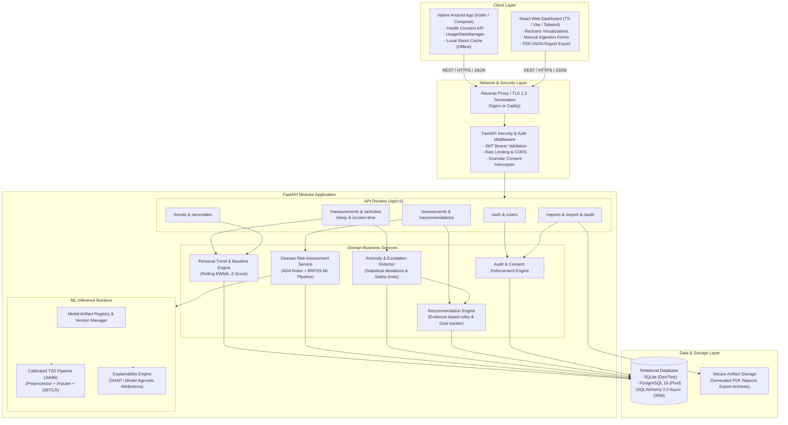
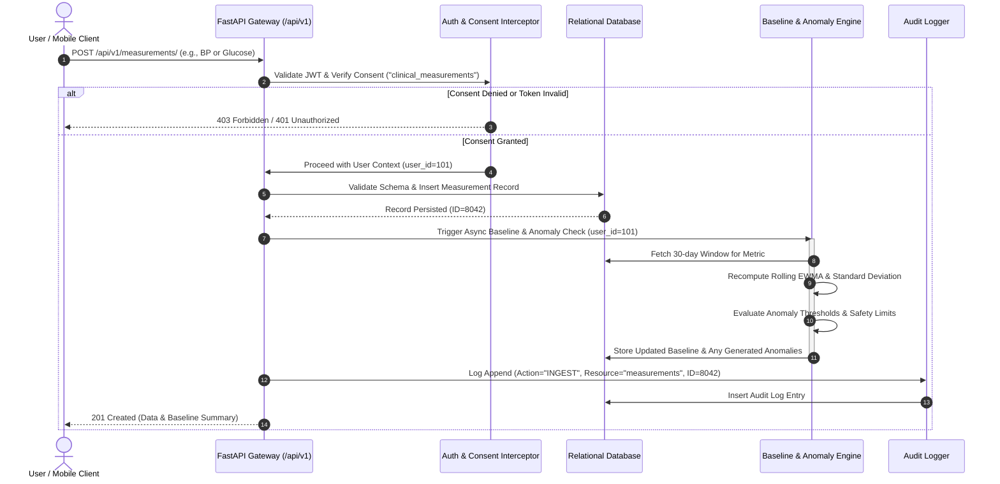
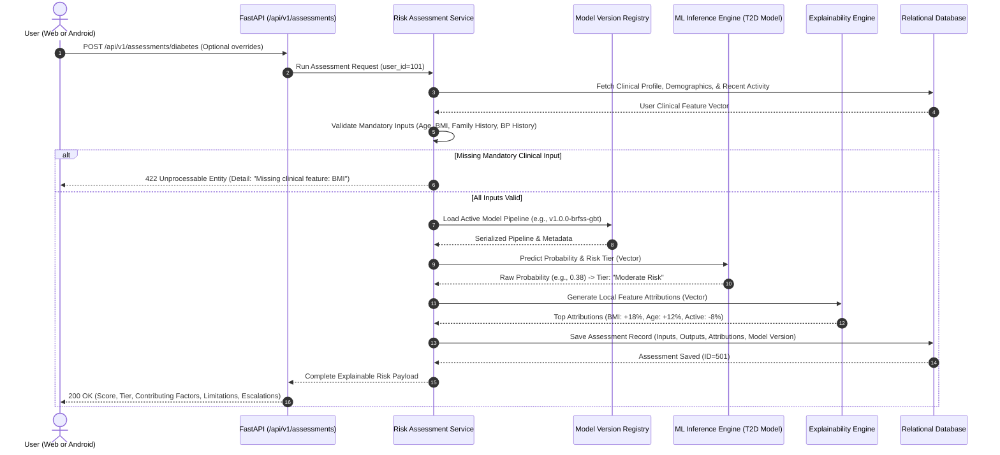
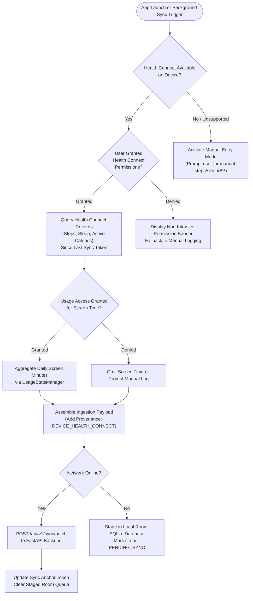

# Wellness Anticipator — System Architecture Document

**Document Version:** 1.0.0  
**Phase:** Phase 0 (Planning & Architecture)  
**Status:** Approved for Baseline Design  
**Author:** Principal Software Architect & Multi-Platform Engineering Lead  

---

## 1. Architectural Philosophy & Strategy

The Wellness Anticipator system is designed around five core engineering principles:

1. **Modular Monolith over Premature Microservices:** For a hackathon and early production prototype, distributed microservices introduce operational overhead, distributed transaction failures, network latency, and deployment complexity. We employ a strictly decoupled, modular monolith in FastAPI with isolated domain modules (Auth, Clinical Profile, Telemetry Ingestion, Trend Analysis, Risk Engines, and Audit).
2. **Contract-Driven Cross-Platform Parity:** Both the native Android application (Kotlin) and the Web dashboard (React/TypeScript) consume the exact same versioned RESTful JSON API (`/api/v1/`). Data schemas are maintained in canonical Pydantic models with exported OpenAPI 3.1 specifications.
3. **Clinical Inference & Pipeline Isolation:** Model training and dataset processing exist in a dedicated ML workspace (`/ml`), isolated from production web server dependencies. Serialized model artifacts (`.joblib`, pipeline preprocessors, and metadata manifests) are loaded at server startup into read-only, in-memory inference runtimes.
4. **Sensor Heterogeneity & Graceful Fallback:** Wearables and mobile operating systems have erratic data availability. The system treats native sensor inputs (Health Connect, UsageStats) as progressive enhancements: if permissions are revoked, hardware is absent, or device APIs fail, the architecture smoothly shifts to validated manual entry forms without breaking client state.
5. **Zero-Trust User Data Isolation:** Every telemetry record, measurement, and assessment is strictly scoped by tenant `user_id` enforced at the database repository boundary, backed by immutable audit trails.

---

## 2. High-Level System Architecture Diagram



---

## 3. Subsystem Breakdown & Responsibilities

### 3.1 Android Mobile Application (Kotlin)
- **Architecture:** Modern Android MVVM / MVI architecture utilizing Jetpack Compose, Kotlin Coroutines, StateFlow, and Jetpack Navigation.
- **Health Connect Integration:** Communicates with the `androidx.health.connect.client.HealthConnectClient`. Handles runtime availability checks (`HealthConnectClient.getSdkStatus`), permission requests for `StepsRecord`, `TotalCaloriesBurnedRecord`, and `SleepSessionRecord`, and differential synchronization.
- **Screen Time Aggregator:** Interacts with `android.app.usage.UsageStatsManager` subject to user-granted `PACKAGE_USAGE_STATS`. Summarizes daily screen minutes, screen unlock frequency, and category breakdowns without harvesting application-specific sensitive metadata.
- **Offline Resilience:** Employs an offline-first Room database for buffering telemetry. If network is lost, pending records remain safely staged and sync automatically when connectivity resumes.
- **Security:** Secure storage of JWT tokens inside `EncryptedSharedPreferences` backed by the Android Keystore system.

### 3.2 React Web Dashboard (TypeScript & Vite)
- **Architecture:** Single-Page Application (SPA) built with React 18/19, TypeScript, Vite, and TailwindCSS for modern, accessible UI components.
- **Data Visualization:** Employs Recharts and custom SVG components for multi-metric overlays (e.g., dual-axis sleep duration vs. sedentary screen time; blood pressure trend bands with target ranges).
- **Manual Data Entry:** Highly responsive, accessible forms with client-side validation for users without wearable devices, including blood pressure, fasting blood glucose, sleep journals, and lifestyle check-ins.
- **Export & Reports:** Client-side preview and triggering of standardized health reports (PDF rendering via headless backend templates or browser print styles; complete JSON/CSV export archives).

### 3.3 Python FastAPI Backend
- **Framework:** FastAPI utilizing asynchronous ASGI (Uvicorn), Pydantic v2 for data validation, and SQLAlchemy 2.0 ORM.
- **Routing & Controllers:** Structured domain routers under `/api/v1/` ensuring strict separation of concerns.
- **Database Abstraction:** Database access is abstracted via the Repository Pattern. The system natively supports SQLite for rapid zero-dependency local development and CI testing, and connects seamlessly to PostgreSQL for production deployments via asyncpg.
- **Background Tasks:** Non-blocking asynchronous calculation of baseline rollups, audit log archiving, and export generation using FastAPI background tasks.

### 3.4 AI/ML & Personal Baseline Engines
- **Personal Baseline Engine (Pure Math/Stat):**
  - Maintains rolling 7-day, 14-day, and 30-day baseline statistics for each metric.
  - Implements Exponentially Weighted Moving Averages (EWMA) to discount older records while responding to meaningful lifestyle shifts:
    $$EWMA_t = \alpha \cdot X_t + (1 - \alpha) \cdot EWMA_{t-1}$$
  - Computes dynamic user Z-scores ($Z = \frac{x - \mu}{\sigma}$) to detect personal deviations without using rigid universal cutoffs.
- **Disease-Risk Assessment Service (Hybrid Clinical/ML):**
  - **Deterministic Clinical Screener:** Implements the validated American Diabetes Association (ADA) 7-question Risk Score and FINDRISC screening calculator as deterministic, verified scoring baselines.
  - **Calibrated ML Model:** Pre-trained, calibrated tabular model (Logistic Regression baseline + LightGBM / Gradient Boosting) trained on verified CDC BRFSS public health survey data.
  - **Explainability Layer:** Calculates exact local feature attributions (via TreeExplainer/KernelExplainer or linear coefficients), converting raw model outputs into transparent, categorized risk factors (e.g., BMI contribution, physical activity protective effect).
- **Clinical Safety & Anomaly Detection:**
  - Evaluates every measurement against physiological bounds.
  - Immediately triggers escalation flags for critical clinical readings (e.g., Systolic BP $> 180$ or Diastolic BP $> 120$ mmHg) and displays prominent healthcare provider consultation instructions.

---

## 4. End-to-End Data Flows

### 4.1 Ingestion & Baseline Processing Sequence



### 4.2 Risk Assessment Execution Sequence



---

## 5. Mobile Data Synchronization & Graceful Degradation Flow

The Android application operates on a layered capability model:



---

## 6. Repository Layout & Workspace Structure

```
Wellness Anticipator/
├── .gitignore
├── README.md
├── docker-compose.yml
├── docs/                               # Phase 0 Architecture & Specs
│   ├── PROJECT_REQUIREMENTS.md
│   ├── SYSTEM_ARCHITECTURE.md
│   ├── DATABASE_DESIGN.md
│   ├── API_SPECIFICATION.md
│   ├── AI_ML_STRATEGY.md
│   ├── IMPLEMENTATION_ROADMAP.md
│   ├── SECURITY_AND_PRIVACY.md
│   ├── TESTING_STRATEGY.md
│   ├── DECISIONS_AND_ASSUMPTIONS.md
│   └── REQUIREMENTS_TRACEABILITY.md
├── contracts/                          # Shared API & Data Schemas
│   ├── openapi.json
│   └── schemas/
│       ├── health_data.json
│       └── risk_assessment.json
├── backend/                            # Python FastAPI Modular Monolith
│   ├── app/
│   │   ├── api/
│   │   │   ├── v1/
│   │   │   │   ├── endpoints/
│   │   │   │   │   ├── auth.py
│   │   │   │   │   ├── users.py
│   │   │   │   │   ├── measurements.py
│   │   │   │   │   ├── activities.py
│   │   │   │   │   ├── sleep.py
│   │   │   │   │   ├── screen_time.py
│   │   │   │   │   ├── checkins.py
│   │   │   │   │   ├── assessments.py
│   │   │   │   │   ├── recommendations.py
│   │   │   │   │   ├── reports.py
│   │   │   │   │   └── audit_export.py
│   │   │   │   └── router.py
│   │   ├── core/
│   │   │   ├── config.py
│   │   │   ├── security.py
│   │   │   └── database.py
│   │   ├── models/                     # SQLAlchemy 2.0 ORM Entities
│   │   ├── schemas/                    # Pydantic v2 Request/Response Schemas
│   │   ├── services/                   # Business & ML Logic
│   │   │   ├── trend_engine.py
│   │   │   ├── anomaly_service.py
│   │   │   ├── risk_service.py
│   │   │   └── recommendation_service.py
│   │   └── main.py
│   ├── alembic/                        # DB Migration Scripts
│   ├── tests/                          # Backend Unit & Integration Tests
│   ├── requirements.txt
│   └── Dockerfile
├── ml/                                 # Dedicated ML & Research Pipeline
│   ├── data/
│   │   ├── raw/
│   │   ├── processed/
│   │   └── dataset_inventory.md
│   ├── pipelines/
│   │   ├── data_validation.py
│   │   ├── preprocessing.py
│   │   ├── train_diabetes_baseline.py
│   │   ├── train_diabetes_gbt.py
│   │   └── evaluate_model.py
│   ├── models/                         # Serialized Artifacts & Registries
│   │   ├── registry.json
│   │   └── serialized/
│   ├── tests/
│   └── requirements.txt
├── web/                                # React / TypeScript / Vite Dashboard
│   ├── src/
│   │   ├── components/
│   │   ├── pages/
│   │   ├── hooks/
│   │   ├── services/                   # Axios API Clients
│   │   ├── types/
│   │   ├── App.tsx
│   │   └── main.tsx
│   ├── package.json
│   ├── tsconfig.json
│   └── vite.config.ts
└── android/                            # Native Kotlin Android Application
    ├── app/
    │   ├── src/
    │   │   ├── main/
    │   │   │   ├── java/com/wellness/anticipator/
    │   │   │   │   ├── data/           # Health Connect, Room, Network
    │   │   │   │   ├── domain/         # Repositories & Use Cases
    │   │   │   │   └── ui/             # Jetpack Compose Screens & ViewModels
    │   │   │   └── AndroidManifest.xml
    │   └── build.gradle.kts
    ├── build.gradle.kts
    └── settings.gradle.kts
```

---

## 7. Operational & Technical Risk Mitigations

| Risk | Impact | Architectural Mitigation |
|---|---|---|
| **Health Connect Unavailable or Permissions Denied** | High (Missing device telemetry) | Abstracted `HealthDataProvider` interface with automatic graceful fallback to clean, accessible manual entry dialogs. |
| **Model Hallucination or Inappropriate Diagnosis** | Critical (Clinical / Ethical) | Absolute architectural wall: models output risk percentages with disclaimers; diagnostic text is prohibited; high-risk readings trigger standard provider escalation notices. |
| **Data Bleeding Across User Accounts** | Critical (Privacy / Security) | Strict tenant-scoping enforced via ORM query filters wrapped in repository classes; automated multi-tenant isolation unit tests in CI. |
| **Drift Between Web and Android API Payloads** | High (Broken Client Integration) | Single source of truth OpenAPI JSON exported from FastAPI Pydantic models; automated schema validation tests run against mock payloads for both clients. |
